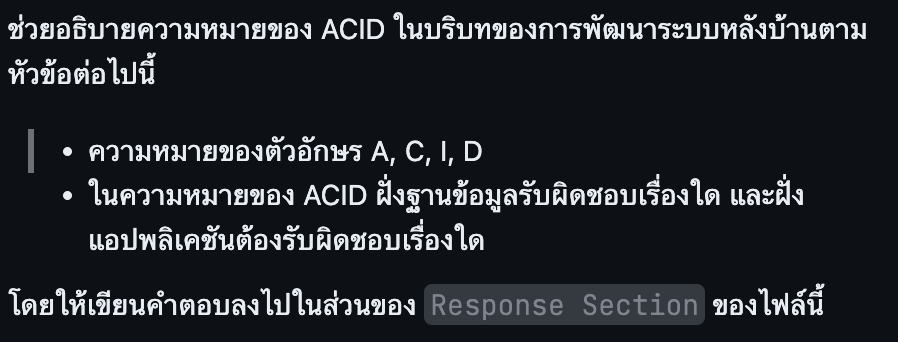

## Question

## Response Section

ACID คือคุณสมบัติพื้นฐานของ transaction ในระบบฐานข้อมูลโดยมุ่งเน้นการจัดการกับ transaction จำนวนมากโดยจะเน้นไปที่ความถูกต้องของข้อมูลถึงแม้จะมี error เกิดขึ้นโดยอักษรแต่ละตัวจะแสดงความหมายตามข้อต่อไปนี้
 - **A Atomicity:** คือการทำงานต้องสามารถ rollback ได้เมื่อเกิด error จุดใดจุดหนึ่งและจะสำเร็จต่อเมื่อทั้งหมดสำเร็จเท่านั้น
 - **C Consistency:** คือความถูกต้องของข้อมูลที่เปลี่ยนไปหรือบันทึกลงไป
 - **I Isolation:** คือการทำงานของแต่ละ transaction จะต้องแยกออกจากกันไม่ไปรบกวนกันหรือทำให้ส่วนอื่นทำงานไม่ได้
 - **D Durability:** คือข้อมูลมีการบันทึกและจัดเก็บอย่างชัดเจนไม่มีการสูญหายหรือได้รับความเสียหายจากเหตุการณ์ไม่คาดฝันเช่นไฟดับเป็นต้น

ACID สามารถปรับใช้ได้ทั้งฝั่ง Develop และ Database ดังนี้
 - **A:** ฝั่ง Develop สามารถจัดการในส่วนนี้ได้ด้วยการเปิด transaction และทำการ rollback หรือ commit เมื่อทำงานเสร็จส่วนทาง DB นั้นมีระบบการทำงานที่เอื้ออำนวยความสะดวกในเรื่องนี้อยู่แล้ว
 - **C:** ฝั่ง Develop สามารถช่วยในการ validate ข้อมูล ความถูกต้องตาม Business Logic และเซ็ตอัพ model ให้ตรงกับ database เพื่อป้องกันในส่วนนี้ได้ ส่วนทาง DB เราต้องปรับ type ของข้อมูลและเพิ่ม constraints ให้เหมาะสมกับข้อมูลจริง
 - **I:** ในส่วนนี้ทาง DB จะมี default ของแต่ละตัวอยู่แล้วในการป้องกันและแยกแต่ละ transaction ออกจากกันเช่นบาง DB จะมีการสร้าง snapshot ก่อนอ่านข้อมูล เป็นต้น แต่ทาง Develop ก็ต้องจัดการในส่วนของ Code ด้วยเช่นกันเช่น ใช้ `SELECT ... FOR UPDATE` เพื่อกันไม่ให้ transaction อื่นมารบกวน หรืออาจต้องเขียน retry ในกรณีของการเกิด deadlock ไว้ด้วยเป็นต้น
 - **D:** โดยปกติทางฝั่ง Develop จะมีการเช็ค connection ของ DB ก่อนที่จะใช้งานและรอตรวจสอบ response ของ DB ทุกครั้ง ส่วนทาง DB เราอาจจะมีการทำ replication หรือ backup ข้อมูลเอาไว้เสมอๆ